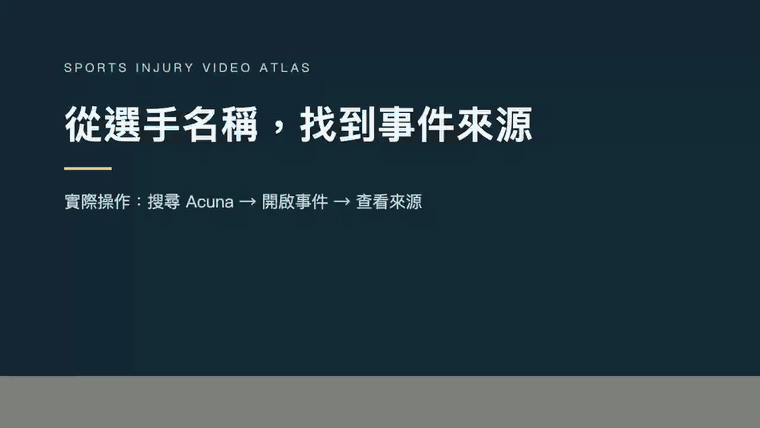

# 運動傷害影片圖鑑 · Sports Injury Video Atlas

給運動醫學學習者與教學者的影片索引：依選手、運動項目與受傷部位找素材，接著查閱事件來源與回場脈絡。由運動醫學科吳易澄醫師策劃。

**[開啟網站 →](https://injury.sportsmedicine.tw/)** · [English](README.en.md) · [參與貢獻](CONTRIBUTING.md) · [程式碼授權與內容範圍](LICENSE-SCOPE.md)

[](https://injury.sportsmedicine.tw/)

## 可以拿來做什麼？

- **找教學素材**：搜尋選手與中英文關鍵字，依運動、部位、影片類型縮小範圍。
- **追查資訊來源**：從事件頁回到原始報導與影片，區分可見動作、公開資訊和醫療解讀。
- **閱讀回場脈絡**：查看有來源的事件時間與後續資訊；保留未知與個別差異。
- **研究介面實作**：分類狀態返回、長文目錄、相關影片、深色模式、字級與鍵盤操作。

截至 2026-10-20，公開網站收錄 **200 支影片、30 種運動、14 個部位**，包含 7 個核心案例與 193 個觀察頁。兩者的資料深度與審查流程不同，不能視為 200 份同等級的臨床案例。影片類型可能重疊，不宜直接相加。網站主要使用繁體中文，支援英文選手名稱搜尋，尚無完整英文介面。

這是教育與資料探索工具，不能用影片確診、開立治療處方或決定回場時間，也不是可直接用於診斷模型訓練的標註資料集。目前沒有對外宣稱使用人數或教學成效。影片由原平台提供，嵌入與播放可能隨地區或權利人設定改變。

## 本機開始

需要 Git 與 **Node.js 24.14.0**（[`.node-version`](.node-version)）。Ubuntu 請先安裝中文字型，讓分享圖片與相關測試能正確呈現中文：

```bash
sudo apt-get update
sudo apt-get install -y fonts-noto-cjk
git clone https://github.com/keanu77/professional-sports-injury-atlas.git
cd professional-sports-injury-atlas
npm ci
npm run dev -- --host 127.0.0.1
```

macOS 可省略兩行 `apt-get`。依終端機顯示的網址開啟網站。Repository 尚未公開時，clone 需要獲授權的 GitHub 帳號；線上網站不需帳號。

預設啟動的是 **review 模式**，供開發與審閱使用，與線上公開站內容不同。一般本機開發不需 API key。資料來源驗證會使用 Git 歷史，請完整 clone，不要使用 Download ZIP 或 `--depth 1`。完整檢查需要已提交、乾淨的工作樹，見[開發指南](docs/development.md)。

| 指令                                  | 用途                                       |
| ------------------------------------- | ------------------------------------------ |
| `npm run check`                       | Astro 與 TypeScript 檢查                   |
| `npm run test:unit`                   | 單元與資料契約測試                         |
| `npm run build:review`                | 產生 review 靜態網站                       |
| `npm run verify:review-artifact`      | 檢查已產生的 review 產物                   |
| `npm run preview -- --host 127.0.0.1` | 預覽已建置的網站                           |
| `npm run video:health`                | 檢查外部影片與來源狀態；不等於實際播放測試 |

## 架構與發布

Astro、TypeScript 與少量瀏覽器互動程式；正式環境使用 Cloudflare Pages、Functions 與 D1。一般 Astro 本機伺服器不會啟動 Cloudflare API，因此熱門排行、觀看統計與投稿等服務須另設 Cloudflare 開發環境。

公開發布另有來源、內容審閱、資產權利與播放驗證門檻。`release:public` 是維護者的發布流程，不是安裝步驟。Fork 時請建立自己的內容與審閱流程，不要沿用本站的審閱簽章宣稱新內容已獲核可。

- [開發與驗證指南](docs/development.md)
- [內容契約](docs/content-contract.md)與[初始架構紀錄](docs/architecture.md)
- [第三方素材說明](THIRD_PARTY_NOTICES.md)
- [版本紀錄](CHANGELOG.md)

`docs/decisions/`、`docs/reviews/` 與 `docs/superpowers/` 保留歷史決策及驗證快照；其中的日期、數量與 review-only 狀態代表當時版本，不是目前網站狀態。

## 參與

歡迎修正文件、改善無障礙與搜尋，或提供可查證的影片來源。請先讀 [CONTRIBUTING.md](CONTRIBUTING.md)。不用寫程式也可透過[網站投稿頁](https://injury.sportsmedicine.tw/contribute/)提出影片與資料修正。安全漏洞請依 [SECURITY.md](SECURITY.md) 私下回報。

如果這份索引或介面實作對你有幫助，歡迎給一顆 Star，方便之後回來查找。

## 授權

自有程式碼與開發文件採 [MIT](LICENSE)。**醫療編輯內容、收錄資料與第三方影音圖片不包含在程式碼的 MIT 授權內**；完整邊界見 [LICENSE-SCOPE.md](LICENSE-SCOPE.md)。原平台的播放權限不等於下載、再散布或改作授權。

本專案獨立運作，與影片平台、職業聯盟、球隊及選手無隸屬或背書關係。
